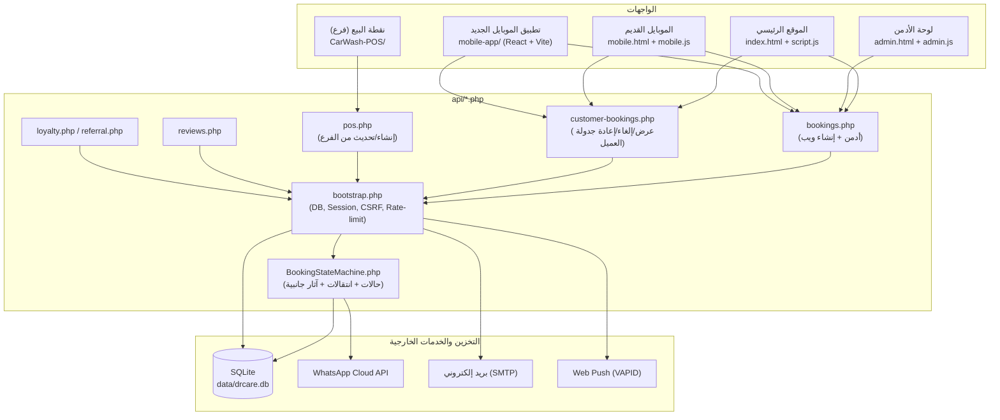
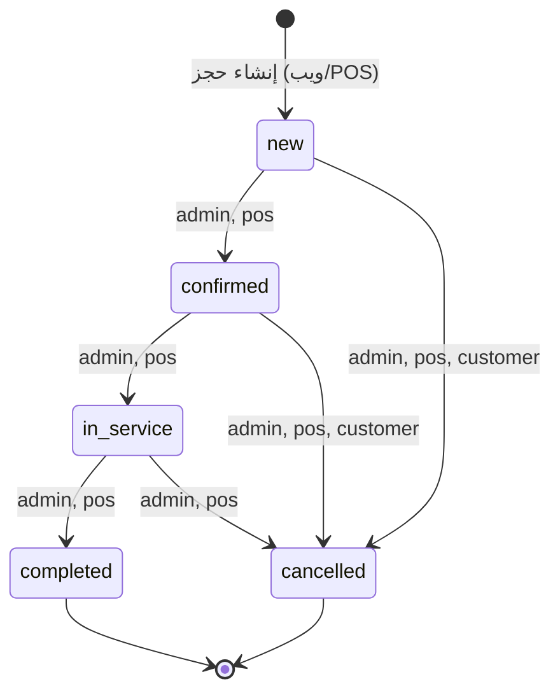
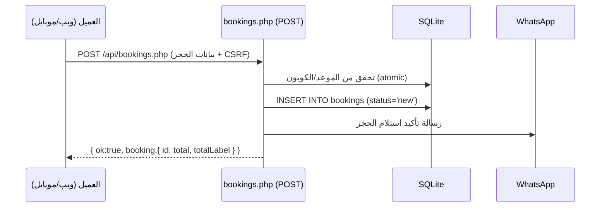
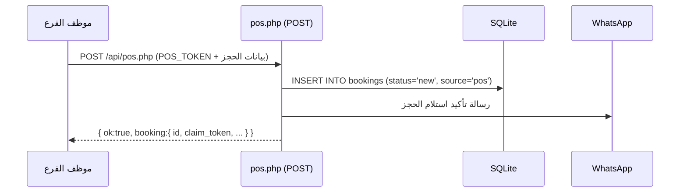
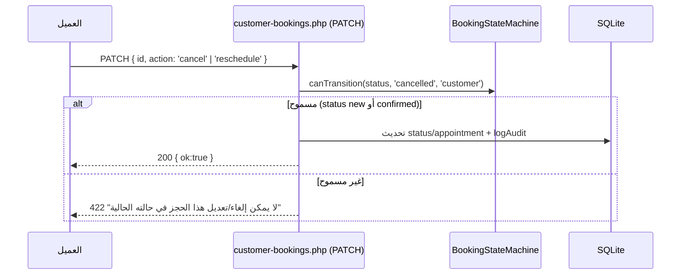
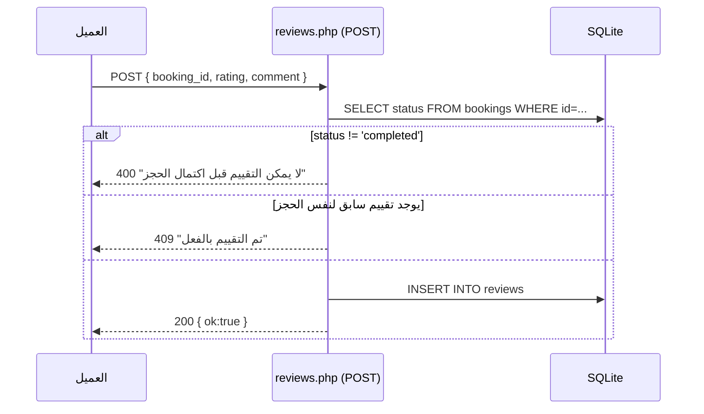

# نظام Workflow الحجز — DR.Care

هذا المستند هو مصدر التوثيق الرسمي لسير عمل الحجز (Booking Workflow) بالكامل: من واجهات المستخدم المختلفة، عبر الـ API، وصولاً لقاعدة البيانات. للتفاصيل الشاملة لكل ميزة في المشروع راجع `FEATURES.md`.

## 1) نظرة معمارية عامة

كل الواجهات (ديسكتوب، أدمن، نقطة البيع، الموبايل القديم، تطبيق الموبايل الجديد) تتصل بنفس طبقة الـ API (`api/*.php`)، والتي تمر جميعها عبر `api/bootstrap.php` (اتصال قاعدة البيانات، الجلسات، CSRF، Rate limiting) وتستخدم `api/BookingStateMachine.php` كمصدر الحقيقة الوحيد لحالة الحجز.



## 2) دورة حياة الحجز (State Machine)

مصدر الحقيقة الوحيد: **`api/BookingStateMachine.php`**. يُستدعى من الأماكن الثلاثة التي تغيّر حالة الحجز (`api/bookings.php` PATCH، `api/pos.php` PATCH، `api/customer-bookings.php` PATCH) بدل تكرار فحص enum في كل ملف.



- **لا يمكن تخطي حالات** (مثلاً `new → completed` مباشرة مرفوض، `409`).
- **لا يمكن الرجوع لحالة سابقة** (`completed → new` مرفوض).
- العميل نفسه يقدر يلغي حجزه فقط من `new`/`confirmed` (نفس القاعدة القديمة، الآن معمَّمة عبر `BookingStateMachine::canTransition()`).
- عند الوصول لـ `completed` أو `cancelled`: يُمسح `payment_screenshot` تلقائياً.
- عند الوصول لـ `completed` لأول مرة: تُمنح نقاط ولاء + مكافأة إحالة (إن وُجدت).
- عند أي انتقال فعلي (`confirmed`/`in_service`/`completed`/`cancelled`): تُرسل رسالة واتساب مناسبة للعميل — **الآن من `bookings.php` (أدمن) و`pos.php` (الفرع) معاً**، بعد ما كانت مقتصرة على الأدمن فقط.

## 3) تسلسلات (Sequence Diagrams)

### إنشاء حجز من الموقع/الموبايل (عميل مسجّل)



### إنشاء حجز من نقطة البيع (POS)



### تحديث حالة الحجز (أدمن أو POS)

```mermaid
sequenceDiagram
  participant Actor as الأدمن / موظف الفرع
  participant API as bookings.php أو pos.php (PATCH)
  participant SM as BookingStateMachine
  participant DB as SQLite
  participant WA as WhatsApp

  Actor->>API: PATCH { id, status: newStatus }
  API->>SM: assertTransition(from, to, actorType)
  alt انتقال غير صالح
    SM-->>API: BookingTransitionException
    API-->>Actor: 409 "لا يمكن تغيير حالة الحجز..."
  else انتقال صالح
    API->>DB: UPDATE bookings SET status=...
    API->>DB: INSERT INTO audit_log (logAudit)
    API->>SM: applyStatusSideEffects(from, to)
    SM->>DB: منح نقاط ولاء (لو completed لأول مرة)
    SM->>WA: إرسال رسالة الحالة الجديدة
    API-->>Actor: 200 { ok:true }
  end
```

### إلغاء/إعادة جدولة من العميل



### التقييم (Review)



## 4) ملاحظة توافق مع `mobile-app/` (React)

تطبيق الموبايل الجديد (`mobile-app/`) كان يفترض شكل رد مختلف عن الـ API الفعلي (`d.logged_in` بدل `d.authenticated`، `d.success` بدل `d.ok`، `bookings.php?action=list` بدل `customer-bookings.php`، ومفاتيح حالة `pending/in_progress` بدل `new/in_service`). تم إصلاح هذه الفروقات في الشاشات: `useAuth.jsx`, `LoginScreen.jsx`, `BookingScreen.jsx`, `BookingSuccessScreen.jsx`, `BookingsScreen.jsx` — بدون تغيير أي عقد في الـ backend نفسه.

## 5) الاختبارات

- `tests/Unit/BookingStateMachineTest.php` — يغطي كل حواف الانتقال المسموحة/الممنوعة لكل نوع مستخدم (admin/pos/customer) بمعزل عن الشبكة/القاعدة.
- `tests/Integration/BookingFlowTest.php`, `PosApiTest.php`, `ReviewsTest.php` — يغطون منع تخطي/عكس الحالات عبر HTTP فعلي، ومنح نقاط الولاء عند اكتمال حجز POS مرتبط بعميل.
