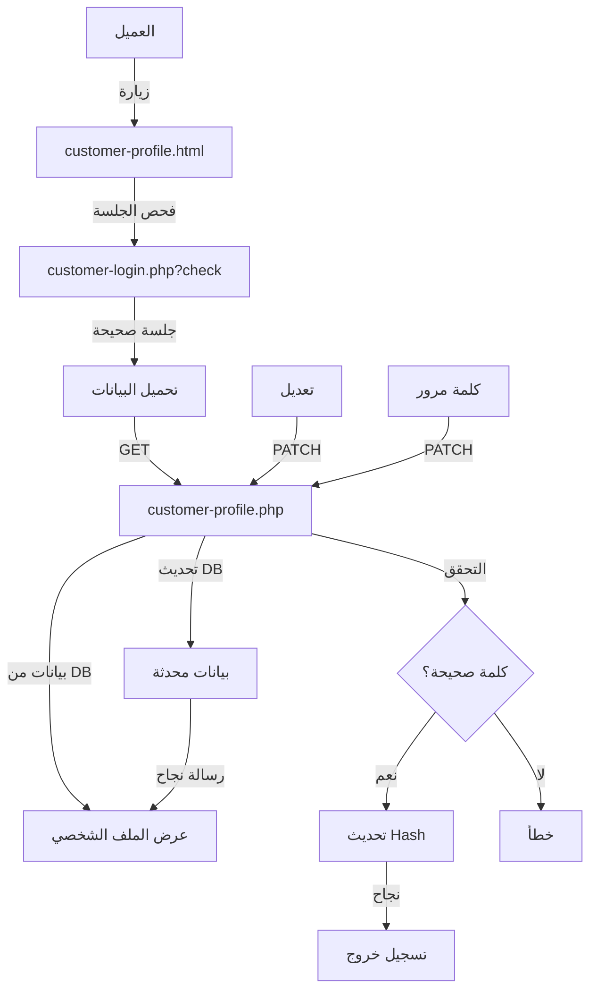

# 👤 واجهة إدارة الملف الشخصي في DR.Care

## نظرة عامة

تم إضافة صفحة شاملة لإدارة الملف الشخصي للعميل تتيح:

✅ **عرض البيانات الشخصية** - الاسم، البريد، الموبايل
✅ **تعديل البيانات** - تحديث الاسم والموبايل
✅ **تغيير كلمة المرور** - مع التحقق من كلمة المرور الحالية
✅ **عرض النشاط** - تاريخ الانضمام، آخر دخول، عدد الحجوزات
✅ **تسجيل خروج آمن** - من صفحة الملف الشخصي

---

## الملفات الجديدة

### `customer-profile.html`
صفحة إدارة الملف الشخصي الكاملة مع 3 تبويبات:

#### تبويب 1: البيانات الشخصية
- عرض بيانات العميل
- تعديل الاسم والموبايل
- تحقق من صحة البيانات
- حفظ آمن

#### تبويب 2: كلمة المرور
- إدخال كلمة المرور الحالية
- إدخال كلمة مرور جديدة
- تأكيد كلمة المرور الجديدة
- رسائل أمان وتوجيهات

#### تبويب 3: النشاط
- تاريخ الانضمام
- آخر دخول
- عدد الحجوزات
- حالة الحساب
- زر تسجيل الخروج

### `api/customer-profile.php`
API لإدارة الملف الشخصي:

```
GET /api/customer-profile.php
```

يعيد بيانات العميل الكاملة:
```json
{
  "ok": true,
  "customer": {
    "id": 1,
    "name": "أحمد محمد",
    "email": "ahmed@email.com",
    "phone": "01012345678",
    "created_at": "2026-06-01T12:00:00Z",
    "last_login": "2026-06-02T10:30:00Z",
    "is_active": 1,
    "booking_count": 5
  }
}
```

#### تحديث البيانات:

```
PATCH /api/customer-profile.php
Content-Type: application/json

# تحديث الاسم والموبايل
{
  "name": "أحمد محمد علي",
  "phone": "01098765432"
}
```

**الاستجابة:**
```json
{
  "ok": true,
  "message": "تم تحديث البيانات الشخصية"
}
```

#### تغيير كلمة المرور:

```
PATCH /api/customer-profile.php
Content-Type: application/json

{
  "current_password": "password123",
  "new_password": "newpassword456"
}
```

**الاستجابة:**
```json
{
  "ok": true,
  "message": "تم تحديث كلمة المرور"
}
```

---

## التعديلات على الملفات الموجودة

### `customer-bookings.html`
- إضافة رابط "حسابي" في رأس الصفحة
- توجيه مباشر إلى `customer-profile.html`

### `index.html`
- إضافة رابط "تسجيل دخول العملاء"
- إضافة رابط "حسابي" في الـ footer

---

## معايير التحقق

### عند تعديل البيانات:

| الحقل | الشرط | مثال |
|------|------|------|
| **الاسم** | 2-80 حرف عربي/إنجليزي | أحمد محمد |
| **الموبايل** | صيغة مصرية `01[0125]XXXXXXXX` | 01012345678 |

### عند تغيير كلمة المرور:

| الحقل | الشرط |
|------|------|
| **كلمة المرور الحالية** | يجب أن تكون صحيحة |
| **كلمة المرور الجديدة** | 6 أحرف على الأقل |
| **التأكيد** | يجب أن تطابق الجديدة |

---

## تدفق الاستخدام

### 1️⃣ دخول صفحة الملف الشخصي

```
1. العميل يضغط على "حسابي"
2. فحص تلقائي للجلسة
3. تحميل بيانات الملف الشخصي
4. عرض معلومات العميل في الرأس
```

### 2️⃣ تعديل البيانات الشخصية

```
1. ينقر على تبويب "البيانات الشخصية"
2. يعدّل الاسم أو الموبايل
3. ينقر "حفظ التغييرات"
4. التحقق من الصحة (client + server)
5. تحديث البيانات في قاعدة البيانات
6. رسالة نجاح
```

### 3️⃣ تغيير كلمة المرور

```
1. ينقر على تبويب "كلمة المرور"
2. يدخل كلمة المرور الحالية
3. يدخل كلمة مرور جديدة
4. يؤكد كلمة المرور الجديدة
5. ينقر "تحديث كلمة المرور"
6. التحقق والتحديث في قاعدة البيانات
7. إعادة توجيه لصفحة الحجوزات
```

### 4️⃣ عرض النشاط

```
1. ينقر على تبويب "النشاط"
2. عرض معلومات الحساب والنشاط
3. خيار تسجيل الخروج
```

---

## الأمان 🔒

✅ **Bcrypt Hashing**: كلمات المرور مشفرة وآمنة
✅ **جلسات محمية**: التحقق من الجلسة قبل كل عملية
✅ **SQL Injection Prevention**: استخدام `PDO` مع `prepared statements`
✅ **Password Verification**: التحقق من كلمة المرور الحالية قبل التغيير
✅ **HTTPS Recommended**: استخدم HTTPS في الإنتاج
✅ **رسائل خطأ آمنة**: عدم كشف معلومات حساسة

---

## الواجهة والتصميم

### الألوان والنمط
- يتبع نفس نمط DR.Care
- خلفية داكنة مع تركيزات ذهبية
- أيقونات بسيطة وواضحة

### الاستجابية
- متوافق مع الهاتف المحمول
- تبويبات سهلة الاستخدام
- أزرار كبيرة وسهلة الضغط

### سهولة الاستخدام
- تعليمات واضحة لكل حقل
- رسائل خطأ تفصيلية
- رسائل نجاح فورية

---

## الميزات المستقبلية

### تحسينات مقترحة:

1. **صورة الملف الشخصي**
   - تحميل صورة شخصية
   - قص وتعديل الصورة

2. **المعلومات الإضافية**
   - العنوان
   - المحافظة
   - نطاق الخدمة المفضل

3. **الإشعارات**
   - إشعارات البريد الإلكتروني
   - تنبيهات حالة الحجز

4. **التوثيق الثنائي**
   - أمان إضافي
   - رسائل SMS

5. **سجل الأمان**
   - قائمة بمحاولات الدخول
   - أجهزة مسجلة الدخول

---

## التكامل مع النظام



---

## الأسئلة الشائعة

### س: هل يمكن للعميل تغيير بريده؟
**ج:** لا حالياً لأن البريد هو المعرّف الفريد. يمكن إضافة ميزة التحقق من البريد الجديد لاحقاً.

### س: كم مرة يمكن تغيير كلمة المرور؟
**ج:** بلا حد. يمكن تغييرها في أي وقت من تبويب "كلمة المرور".

### س: ماذا يحدث عند نسيان كلمة المرور؟
**ج:** يمكن إضافة "نسيت كلمة المرور؟" في صفحة تسجيل الدخول لاحقاً.

### س: هل البيانات مشفرة؟
**ج:** كلمات المرور مشفرة بـ bcrypt. البيانات الأخرى محمية بـ HTTPS.

---

## الدعم

للأسئلة أو المشاكل:
- تحقق من سجلات الأخطاء: `error_log`
- تحقق من قاعدة البيانات: `/data/drcare.db`
- اختبر الاتصال: استخدم Postman لاختبار API

---

**آخر تحديث:** 2026 | **الإصدار:** v2.3
